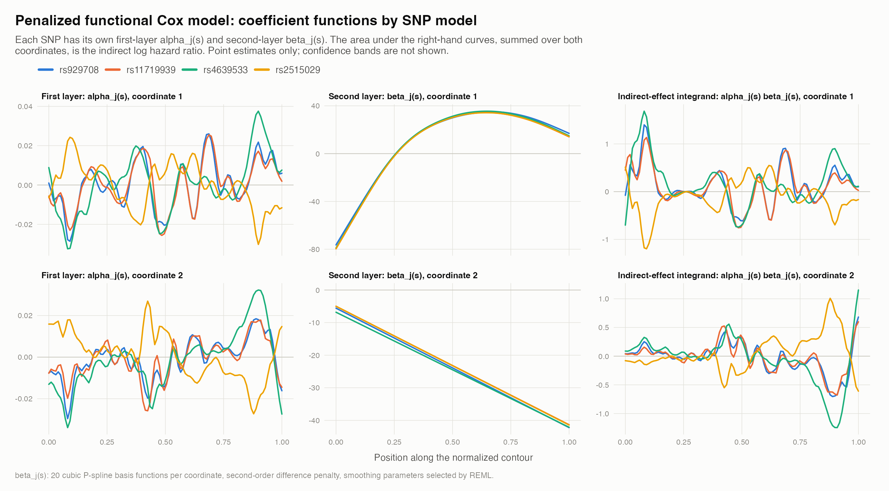

# Penalized Functional Cox Model

## Overview

This analysis replaces the FPCA-truncated second layer of the functional linear Cox regression model (FLCRM) with a penalized functional Cox model, following the penalized scalar-on-function approach of [S-GMAS](https://github.com/Naomi-Ding/S-GMAS) (`refund::pfr` with `lf()` terms), adapted to a time-to-event outcome:

```text
SNP exposure -> corpus callosum shape -> time to AD conversion
```

The analysis sample is unchanged: 332 participants with baseline LMCI, 145 observed AD conversion events, and 187 censored observations. Four SNPs were evaluated in separate models. The corpus callosum square-root velocity function (SRVF) has two coordinate functions over 100 contour positions.

The adjustment set contains sex, standardized age, handedness, APOE4, genetic ancestry PC1 and PC2, and education years. The first-layer shape model also contains an intercept.

**Motivation.** In the FLCRM, the indirect effect came almost entirely from the first of the 18 retained FPCs, and the remaining coefficients mainly added variance. Fixed-K choices, a ridge penalty on the FPC coefficients, coordinate-specific FPCA, and pre-smoothing did not resolve this. A roughness penalty removes the need to choose K and lets REML determine the effective complexity of the shape coefficient.

## Model

### First layer: SNP to shape (unchanged)

$$M_j(s) = \alpha_j(s)\,X + \lambda_j(s)^\top W + \varepsilon_j(s), \qquad j = 1, 2$$

Pointwise least squares at all 200 positions (2 coordinates x 100 grid points), followed by GCV smoothing-spline smoothing of each coefficient function along the contour, gives $\alpha_1(s)$ and $\alpha_2(s)$.

### Second layer: shape to hazard (new)

$$h_i(t) = h_0(t)\exp\Big[\tau X_i + \kappa^\top W_i + \sum_{j=1}^{2}\int_0^1 M_{ij}(s)\,\beta_j(s)\,ds\Big]$$

- Each $\beta_j(s) = \sum_{k=1}^{20} b_{jk} B_k(s)$ is represented by 20 cubic P-spline basis functions.
- The integral is computed with trapezoid weights, which turns each coordinate into 20 derived covariates.
- The coefficients maximize the penalized partial likelihood (Breslow ties):

$$\ell_{\mathrm{partial}}(\tau, \kappa, b_1, b_2) - \tfrac{1}{2}\lambda_1\, b_1^\top S\, b_1 - \tfrac{1}{2}\lambda_2\, b_2^\top S\, b_2$$

- $S$ is the second-order difference penalty, which penalizes curvature of $\beta_j(s)$. Straight lines are unpenalized.
- The smoothing parameters $\lambda_1, \lambda_2$ are selected by REML (`mgcv::gam`, `cox.ph` family). The SNP and confounder coefficients are unpenalized.

| SNP model | EDF of $\beta_1(s)$ | EDF of $\beta_2(s)$ | $\lambda_1$ | $\lambda_2$ |
|---|---:|---:|---:|---:|
| `rs929708` | 3.67 | 2.00 | 0.514 | 2,625 |
| `rs11719939` | 3.73 | 2.00 | 0.484 | 2,513 |
| `rs4639533` | 3.72 | 2.00 | 0.488 | 2,483 |
| `rs2515029` | 3.72 | 2.00 | 0.491 | 2,490 |

The shape term uses about 5.7 effective degrees of freedom, compared with 18 FPC coefficients in the FLCRM. $\beta_2(s)$ is shrunk to the unpenalized linear null space. Results were essentially identical with 10, 20, or 30 basis functions per coordinate (indirect HRs differed by at most 0.001).

### Effect definitions

$$\text{Direct HR} = e^{\tau}, \qquad \text{Indirect HR} = \exp\Big[\sum_{j=1}^{2}\int_0^1 \alpha_j(s)\,\beta_j(s)\,ds\Big], \qquad \text{Total HR} = \text{Direct HR} \times \text{Indirect HR}$$

Hazard ratios are reported per one additional coded allele. The prepared source object does not document the identity or orientation of the coded allele, so the estimates should be interpreted per additional coded allele until the allele metadata are verified.



## Inference

Two bootstrap schemes were used. Both had 10,000 replicates with no failed replicates and no warning-flagged fits.

| | Multiplier wild bootstrap | Pairs bootstrap |
|---|---|---|
| Resampling | Exp(1) subject weights normalized to mean 1, applied to both layers | 332 subjects drawn with replacement |
| Exposure and covariates | Fixed | Resampled |
| Smoothing parameters | Fixed at the full-data REML values | Reselected by REML in every replicate |
| Seed | `20260920`, the same weights as the FLCRM wild bootstrap | `20260905`, the same indices as the FLCRM pairs bootstrap for replicates 1-1,000 |
| Intervals | Basic, percentile, BCa | Percentile, basic, BCa |

`mgcv::cox.ph` uses the `weights` argument for the event indicator, so the weighted second layer was refitted with `survival::coxph` after rewriting the penalty as an equivalent ridge problem. With unit weights, this reproduces the REML fit to within 1e-7.

**BCa intervals** (bias-corrected and accelerated; Efron, 1987) adjust the percentile positions with two quantities:

- The bias correction $z_0 = \Phi^{-1}\{\#(\hat\theta^*_b < \hat\theta)/B\}$ measures how far the bootstrap distribution is shifted from the point estimate.
- The acceleration $a$, estimated from all 332 leave-one-subject-out fits, measures skewness.

The adjusted probabilities are $\Phi\big(z_0 + (z_0 + z_\alpha)/\{1 - a(z_0 + z_\alpha)\}\big)$ for $z_\alpha = \pm 1.96$. The formula is the same as in [`four_snp_bca_bootstrap`](../four_snp_bca_bootstrap/README.md). The jackknife fits used fixed smoothing parameters for the wild bootstrap and REML reselection for the pairs bootstrap. The acceleration was negligible (|a| < 0.01 for all principal effects), so BCa differs from the percentile interval mainly through $z_0$.

## Main Results

### Point estimates

| SNP | Direct HR | Indirect HR | Total HR | Indirect log HR, coordinate 1 | Indirect log HR, coordinate 2 |
|---|---:|---:|---:|---:|---:|
| `rs929708` | 0.840 | 1.095 | 0.920 | 0.122 | -0.032 |
| `rs11719939` | 0.997 | 1.091 | 1.088 | 0.113 | -0.026 |
| `rs4639533` | 0.864 | 1.135 | 0.981 | 0.189 | -0.062 |
| `rs2515029` | 1.008 | 0.950 | 0.958 | -0.109 | 0.058 |

The indirect point estimates agree in direction and magnitude with the FLCRM estimates (1.070, 1.065, 1.131, and 0.953). The two coordinate contributions have opposite signs, with coordinate 1 dominant.

### Indirect effect: 95% intervals (HR)

| SNP | Wild basic | Wild percentile | Wild BCa | Pairs percentile | Pairs basic | Pairs BCa |
|---|---:|---:|---:|---:|---:|---:|
| `rs929708` | 0.986-1.198 | **1.001-1.216** | **1.002-1.219** | 0.994-1.243 | 0.965-1.206 | 0.985-1.224 |
| `rs11719939` | 0.982-1.193 | 0.997-1.212 | 0.999-1.215 | 0.992-1.244 | 0.956-1.199 | 0.975-1.219 |
| `rs4639533` | 0.990-1.271 | **1.014-1.302** | **1.018-1.307** | **1.005-1.339** | 0.962-1.282 | 0.997-1.322 |
| `rs2515029` | 0.875-1.050 | 0.860-1.032 | 0.863-1.034 | 0.854-1.042 | 0.866-1.058 | 0.857-1.045 |

Bold intervals exclude HR = 1.

### Direct and total effects: 95% BCa intervals (HR)

| SNP | Direct HR (wild BCa) | Direct HR (pairs BCa) | Total HR (wild BCa) | Total HR (pairs BCa) |
|---|---:|---:|---:|---:|
| `rs929708` | 0.840 (0.637-1.121) | 0.840 (0.621-1.161) | 0.920 (0.687-1.256) | 0.920 (0.672-1.289) |
| `rs11719939` | 0.997 (0.753-1.326) | 0.997 (0.742-1.379) | 1.088 (0.808-1.475) | 1.088 (0.800-1.520) |
| `rs4639533` | 0.864 (0.661-1.152) | 0.864 (0.645-1.181) | 0.981 (0.729-1.348) | 0.981 (0.710-1.366) |
| `rs2515029` | 1.008 (0.793-1.271) | 1.008 (0.774-1.306) | 0.958 (0.741-1.236) | 0.958 (0.732-1.259) |

Every direct- and total-effect interval included HR = 1 under all six interval definitions.

### Precision of the indirect effect

Bootstrap standard errors of the indirect log HR:

| SNP | FLCRM, wild | Penalized, wild | FLCRM, pairs | Penalized, pairs |
|---|---:|---:|---:|---:|
| `rs929708` | 0.074 | 0.049 | 0.074 | 0.056 |
| `rs11719939` | 0.078 | 0.049 | 0.080 | 0.057 |
| `rs4639533` | 0.081 | 0.064 | 0.087 | 0.073 |
| `rs2515029` | 0.067 | 0.046 | 0.072 | 0.051 |

Relative to the FLCRM, the penalized model reduced the standard error of the indirect effect by 21% to 37% under the wild bootstrap and by 16% to 29% under the pairs bootstrap.

### BCa corrections for the indirect effect

| SNP | Wild $z_0$ | Wild $a$ | Pairs $z_0$ | Pairs $a$ | Pairs bootstrap bias (log HR) |
|---|---:|---:|---:|---:|---:|
| `rs929708` | 0.019 | -0.0009 | -0.102 | -0.0010 | 0.008 |
| `rs11719939` | 0.022 | -0.0005 | -0.149 | -0.0004 | 0.011 |
| `rs4639533` | 0.012 | 0.0097 | -0.086 | 0.0090 | 0.010 |
| `rs2515029` | 0.022 | 0.0036 | 0.027 | 0.0035 | -0.003 |

Under the pairs bootstrap, the distribution lies to the right of the point estimate for the three positive SNPs (only 44% to 47% of replicates fall below it). BCa corrects for this and shifts the interval toward the basic interval, so the `rs4639533` interval includes 1.

## Interpretation

1. Replacing FPCA truncation with a roughness penalty markedly improved the precision of the indirect effect without shrinking the point estimates, and the estimates were insensitive to the number of basis functions.
2. Under the wild bootstrap, the indirect effects of `rs4639533` and `rs929708` excluded HR = 1 with the percentile and BCa intervals, but not with the basic interval.
3. The wild bootstrap holds the smoothing parameters fixed, so it understates uncertainty. Reselecting them in each replicate (pairs bootstrap) increased the indirect-effect standard errors by 11% to 16%. Under the pairs BCa interval, no indirect effect excluded HR = 1. The `rs4639533` interval was 0.997-1.322.
4. The evidence for shape mediation is therefore suggestive but not robust. `rs4639533` shows a borderline indirect effect (HR 1.135) whose significance depends on the resampling scheme and interval type.

These results are model-based associations and do not by themselves establish causal mediation.

## Limitations

- **Smoothing-parameter uncertainty.** The wild bootstrap does not propagate uncertainty in smoothing-parameter selection. The pairs bootstrap does.
- **Coordinate-specific contributions.** The two contributions have opposite signs and are negatively correlated across wild replicates (r = -0.62 to -0.71). Coordinate-level interpretation should be cautious.
- **Rotation invariance.** Separate smoothing parameters for the two coordinates make the fit depend on the orientation of the SRVF coordinate system. Sharing one smoothing parameter across coordinates would remove this dependence.
- **Product method under Cox.** Event incidence is high (145 of 332, 44%). Because the HR is non-collapsible, the product-of-coefficients indirect effect on the Cox scale is only an approximation unless the outcome is rare (VanderWeele, 2011). A functional accelerated failure time model, under which the product method holds exactly, would be a natural complementary analysis.
- **Unchecked assumptions.** Proportional hazards and the absence of an exposure-mediator interaction have not yet been checked.
- **Analysis history and multiplicity.** This model was adopted after several alternative second-layer specifications had been examined. The intervals are not adjusted for testing four SNPs. The procedure used to select the four SNPs should be documented, because selection on shape association in the same data would inflate the first-layer estimates.
- **Not yet estimated.** The spatial indirect effect $\mathrm{SAIE}(s) = \sum_j \alpha_j(s)\beta_j(s)$ and its simultaneous confidence band.

## Output Files

| File | Content |
|---|---|
| [`penalized_functional_cox_effect_summary.csv`](penalized_functional_cox_effect_summary.csv) | Point estimates, EDFs, and smoothing parameters for 10, 20, and 30 basis functions |
| [`penalized_functional_cox_functions_k20.csv`](penalized_functional_cox_functions_k20.csv) | $\alpha_j(s)$ and $\beta_j(s)$ on the 100-point grid for the main model |
| [`penalized_functional_cox_functions_k20.png`](penalized_functional_cox_functions_k20.png) | Figure of $\alpha_j(s)$, $\beta_j(s)$, and $\alpha_j(s)\beta_j(s)$ |
| [`wild_bootstrap_summary_B10000_seed20260920_k20.csv`](../penalized_functional_cox_wild_bootstrap/wild_bootstrap_summary_B10000_seed20260920_k20.csv) | Wild bootstrap point estimates, standard errors, basic and percentile intervals |
| [`wild_bootstrap_bca_summary_B10000_seed20260920_k20.csv`](../penalized_functional_cox_wild_bootstrap/wild_bootstrap_bca_summary_B10000_seed20260920_k20.csv) | Wild bootstrap basic, percentile, and BCa intervals with $z_0$ and $a$ |
| [`wild_bootstrap_estimates_B10000_seed20260920_k20.csv`](../penalized_functional_cox_wild_bootstrap/wild_bootstrap_estimates_B10000_seed20260920_k20.csv) | Replicate-level wild bootstrap estimates |
| [`fixed_smoothing_parameters_B10000_seed20260920_k20.csv`](../penalized_functional_cox_wild_bootstrap/fixed_smoothing_parameters_B10000_seed20260920_k20.csv) | Smoothing parameters held fixed in the wild bootstrap |
| [`fixed_smoothing_jackknife_n332_k20.csv`](../penalized_functional_cox_wild_bootstrap/fixed_smoothing_jackknife_n332_k20.csv) | Leave-one-subject-out estimates for the wild BCa acceleration |
| [`bootstrap_summary_B10000_seed20260905_k20.csv`](../penalized_functional_cox_bootstrap/bootstrap_summary_B10000_seed20260905_k20.csv) | Pairs bootstrap standard errors, bias, percentile and basic intervals |
| [`bootstrap_estimates_B10000_seed20260905_k20.csv`](../penalized_functional_cox_bootstrap/bootstrap_estimates_B10000_seed20260905_k20.csv) | Replicate-level pairs bootstrap estimates, including the reselected EDFs |
| [`bca_summary_B10000_seed20260905_k20.csv`](../penalized_functional_cox_bca/bca_summary_B10000_seed20260905_k20.csv) | Pairs bootstrap BCa, percentile, and basic intervals with $z_0$ and $a$ |
| [`jackknife_estimates_n332_k20.csv`](../penalized_functional_cox_bca/jackknife_estimates_n332_k20.csv) | Leave-one-subject-out estimates for the pairs BCa acceleration |

The error and warning files in the bootstrap folders contain no failed replicates and no warnings.

## Reproduction

Run the following commands from the `version 2` directory. The last argument of scripts 18 and 19 is the number of CPU cores.

```bash
Rscript code/16_fit_penalized_functional_cox.R
Rscript code/21_plot_penalized_functional_cox.R
Rscript code/17_wild_bootstrap_penalized_functional_cox.R 10000 20260920
Rscript code/20_bca_wild_penalized_functional_cox.R 10000 20260920
Rscript code/18_bootstrap_penalized_functional_cox.R 10000 20260905 6
Rscript code/19_bca_penalized_functional_cox.R 10000 20260905 6
```

The full mediation analysis overview is available in [`../README.md`](../README.md).
